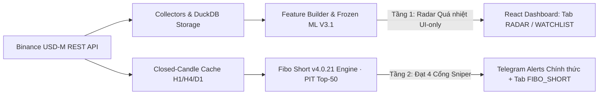

# ⚡ PeakPulse AI — Real-Time Financial Market Anomaly Detection Engine

[](LICENSE)
[](https://www.python.org/)
[](#)
[](#)

[🇻🇳 Tiếng Việt](README.md) | [🇬🇧 English](README.en.md) | [🇨🇳 简体中文](README.zh-CN.md) | [🇷🇺 Русский](README.ru.md) | [🇰🇷 한국어](README.ko.md)

---

> **PeakPulse AI — Time-Series Machine Learning & Anomaly Detection Radar**  
> *Hệ thống phân tích dữ liệu lớn và dự báo các giai đoạn biến động bất thường (Volatility Regimes & Distribution Phases) trên thị trường tài chính phái sinh bằng Máy học thời gian thực.*

---

## 🎯 1. GIỚI THIỆU TỔNG QUAN

**PeakPulse AI** là nền tảng phân tích dữ liệu lớn và nhận diện sớm các mẫu hình bất thường của thị trường tài chính dựa trên dữ liệu dòng tiền và sổ lệnh phái sinh thời gian thực (Point-in-Time Order-Flow & Derivatives Data).

Khác với các công cụ phân tích kỹ thuật truyền thống chỉ dựa vào giá đóng/mở cửa (OHLCV), **PeakPulse AI** kết hợp dữ liệu hành vi vi mô (Funding Rates, Open Interest, Taker Volume Ratios, Account Positioning) và mô hình **Machine Learning (Walk-Forward Validated)** để đưa ra đánh giá xác suất phân phối và biến động bất thường với độ tin cậy cao.

> 💡 **Triết lý vận hành:** Hệ thống hoạt động như một **Radar thông minh giám sát thị trường (Market Intelligence Radar)** với nguyên tắc Human-in-the-loop. PeakPulse AI hoàn toàn phi lưu ký (Non-custodial) và không can thiệp đặt lệnh tự động.

---

## 🔎 2. KIẾN TRÚC & TRẠNG THÁI PHIÊN BẢN PRODUCTION (2 TẦNG PHỐI HỢP)

Bản chính thức của **PeakPulse AI** vận hành theo kiến trúc **2 tầng phân tách rõ vai trò** nhằm loại bỏ rủi ro bắt đỉnh sớm ngược nến bơm, đồng thời giữ khả năng quan sát toàn thị trường mỗi 5 phút (chi tiết tại [**Hướng dẫn Triển khai & Vận hành Bản Chính thức (`docs/PRODUCTION_DEPLOYMENT_GUIDE.md`)**](docs/PRODUCTION_DEPLOYMENT_GUIDE.md)):

| Phân tầng Production | Động cơ / Phiên bản | Vai trò & Kênh phân phối (`configs/live.yaml`) | Bằng chứng kiểm định |
| :--- | :--- | :--- | :--- |
| **Tầng 2 — Tín hiệu Hành động Chính thức (Primary Engine)** | **`Fibo Short v4.0.21`** (`dao_vang.fibo_short`) | **Bắn Telegram Alert 24/7** & hiển thị tại tab **`FIBO_SHORT`**. Chỉ kích hoạt trên rổ `rolling_pit_top50` với 2 chính sách chuẩn: `elite_sniper_risk` & `sniper_rr1_horizon24` (kèm đầy đủ Entry, SL `0.886`, TP1/TP2/TP3, định cỡ `0.5% NAV`). | Kiểm toán danh mục 6 năm (`2020–2025`, 338 mã PIT, `360.781` sự kiện funding thực): **`+26.19%`**, `MaxDD 15.33%` (`elite_sniper_risk`); giai đoạn `2024–2025`: **`+21.46%`** (`sniper_rr1_horizon24`). |
| **Tầng 1 — Radar Cảnh báo Sớm (Overheating Radar)** | **`V3.1 Săn Đỉnh`** (`frozen_20260906_105716_bc3c369b`) | **Chỉ hiển thị trên Web UI (`RADAR` / `WATCHLIST`)**, tắt gửi Telegram trực tiếp (`operating_mode: shadow`, `shadow_telegram_enabled: false`) để theo dõi các Altcoin đang bơm nóng & kiệt sức Funding. | Khóa SHA-256 bundle & fail-closed serving; trạng thái forward-test độc lập: `insufficient_evidence` (không dùng để Short trực tiếp ngược sóng bơm). |
| **Tầng 3 — Giao dịch Tự động (`ExecutionEngine`)** | **`Paper OOS v1`** (`live_activated: false`) | Đang khóa an toàn đặt lệnh tiền thật; chạy 12 tài khoản `paper_oos_v1` thời gian thực để đo độ trượt giá thực tế (`<= 12.5 bps/fill`) trước khi xét duyệt auto-trading. | Giao thức khóa SHA-256 từ `18/10/2026` (`live_signoff = NOT_GRANTED`). |

### Định danh Frozen ML Bundle của Tầng 1 (Radar Sớm)
| Trường | Giá trị đang cấu hình |
| :--- | :--- |
| **Model ID** | **frozen_20260906_105716_bc3c369b** |
| **Train cutoff** | **2026-07-28T19:05:39.999000+07:00** |
| **Frozen threshold** | **0.4100000000000001** |
| **Calibration** | **isotonic_v1** |
| **Model SHA-256** | **27961bc6c9a24e52136d00f208258343e8d5b75980fe156dbfba699264f51a12** |
| **Calibrator SHA-256** | **0e425413f24a3a96ece91d1e201f0be4dd3709526733d19a19d649871b3c72db** |

> **Mục tiêu mới:** pipeline huấn luyện/materialize mặc định dùng
> `distribution_short_v2`: bắt cú giảm **tối thiểu 20% trong 24 giờ**, với
> MAE tối đa **+4%**. Bundle production ghi ở bảng trên vẫn là model v1 cho
> mục tiêu 8%; nó chỉ được giữ làm bằng chứng lịch sử và không được mô tả hay
> promote như model 20%. Cần huấn luyện, hiệu chỉnh và khóa protocol v2 mới
> trước khi đổi `scanner.frozen_model_id`.

Bundle hiện lưu training precision **0.3896**, Brier **0.1859** và ECE
**0.0261**. Đây là số liệu đi kèm quá trình tạo bundle, chưa phải một
forward-test độc lập sau cutoff và không chứng minh ROI hay win rate.

Các cơ chế chống lookahead, embargo, as-of join, calibration, checksum và
fail-closed serving đều có kiểm thử hồi quy. Chỉ số hiệu năng live chỉ được
công bố khi báo cáo gắn đúng model ID/checksum, cửa sổ dữ liệu, sample/event
count và kết quả theo regime. Xem
[mô hình production và mức độ bằng chứng](docs/PRODUCTION_MODEL.md).

### 🔍 Điểm nổi bật về mặt kỹ nghệ

- **Ground-truth có phiên bản:** v1 lịch sử dùng mục tiêu 8%; contract v2 mới
  dùng drawdown 20%/24h, MAE tối đa 4%. Mỗi bundle đóng băng contract trong
  metadata nên hai tập bằng chứng không bị trộn.
- **Xác suất được kiểm soát:** live serving yêu cầu calibrator hợp lệ, feature
  đầy đủ, dữ liệu đủ mới và checksum khớp; nếu không hệ thống fail closed.
- **Human-in-the-loop:** scanner phát cảnh báo và ghi nhận outcome; không tự
  động đặt lệnh và challenger không tự thay champion.
- **Dữ liệu point-in-time:** as-of join và test leakage giảm rủi ro dùng thông
  tin tương lai; kết quả kiểm thử không được diễn giải thành bảo đảm tuyệt đối.

---

## ✨ 3. CÁC TÍNH NĂNG NỔI BẬT

- 🔍 **Live Scanner Daemon (24/7):** Tự động quét theo thời gian thực hàng trăm cặp giao dịch Binance Futures theo chu kỳ nến 5 phút.
- 📊 **Cơ chế Candidate Filter v2 & Pump Filter:** Lọc danh sách coin biến động mạnh, phát hiện bất thường dòng tiền và nguy cơ đảo chiều nhanh chóng.
- 🚨 **Market Anomaly Radar:** Gắn nhãn độc lập cho đột biến khối lượng, funding cực trị/đổi dấu, đảo chiều, OI unwind, đòn bẩy tích tụ, taker sell imbalance, long/short crowding và phá vỡ giả; điểm anomaly 0-100 chỉ là quan sát, không phải xác suất model.
- 🤖 **Machine Learning & Self-Learning Daemon:**
  - Pipeline huấn luyện hỗ trợ calibration; live alert chỉ bật khi bundle có calibration artifact hợp lệ.
  - Đánh giá mô hình bằng **Walk-Forward Validation**, embargo và các kiểm tra hồi quy point-in-time nhằm giảm rủi ro rò rỉ dữ liệu.
- 📲 **Cảnh báo Telegram 24/7:** Gửi thông báo tín hiệu trực tiếp về Telegram cá nhân/group với đầy đủ chỉ số phân tích và đường dẫn mở thẳng coin trên Dashboard.
- 💻 **Giao diện Web Dashboard (React + Vite + TypeScript):**
  - Biểu đồ nến tương tác (Candlestick Chart) chuẩn Trading.
  - Bảng tổng hợp tín hiệu thời gian thực (Signal Feed).
  - Trạng thái sức khỏe hệ thống, lịch sử backtest & theo dõi watchlist linh hoạt.
- 🐳 **Đóng gói Docker Ready:** Sẵn sàng triển khai 1-click bằng Docker & Docker Compose trên VPS/Server.

---

## 🛠 4. KIẾN TRÚC KỸ THUẬT (TECH STACK)

### 🔹 Backend & Data Engine (Python)
- **Core Framework:** Python 3.12, Pydantic v2, Typer (CLI).
- **Web & API Server:** `ThreadingHTTPServer` + REST endpoints; frontend hiện refresh dữ liệu theo chu kỳ.
- **Data Engine & Storage:** DuckDB (Query engine phân tích dữ liệu siêu tốc), Apache Parquet, Pandas.
- **Logging & Security:** `structlog` tích hợp cơ chế tự động ẩn secret/key (`redact_secrets`).

### 🔹 Frontend (Web Dashboard)
- **Framework:** React 19, TypeScript, Vite.
- **Styling & UI:** Modern Vanilla CSS (Clean & Responsive).
- **Charts:** Lightweight Candlestick Charts & polling-based live snapshots.

### 🔹 Machine Learning & Signal Processing
- **Validation Engine:** Walk-Forward Splitter, Event-based Validation, Out-of-fold Calibration.
- **Model Storage:** Frozen Model Bundles (Hash-verified metadata & config).

---

## 🔄 5. CƠ CHẾ HOẠT ĐỘNG (PIPELINE)



1. **Tầng 1 — Quét Quá nhiệt & Lưu trữ (V3.1 ML Radar):** Quét nến OHLCV 5m, Open Interest, Funding Rate, Taker Volume và Long/Short Ratio vào DuckDB; khớp mốc Point-in-Time và chấm điểm bằng Frozen ML Bundle + Market Anomaly Radar để cập nhật danh sách coin bơm nóng trên giao diện Web.
2. **Tầng 2 — Xác nhận Đảo chiều & Phát Tín hiệu Hành động (`Fibo Short v4.0.21`):** Trên rổ `rolling_pit_top50`, kiểm tra 4 nhân tố độc lập (`Prior Pump >= 50%` $\to$ `Impulse Drop >= 6% & KER >= 0.50` $\to$ `Fibo Pullback <= 0.786 & H1 Break Close < Low[-1]` $\to$ `SL Fibo 0.886 <= 12% & Sniper Policy`). Chỉ tín hiệu đạt chuẩn `elite_sniper_risk` hoặc `sniper_rr1_horizon24` mới được bắn thông báo Telegram kèm kế hoạch quản trị vốn `0.5% NAV`.

📖 *Xem chi tiết tại:* [**Hướng dẫn Triển khai & Vận hành Bản Chính thức (`docs/PRODUCTION_DEPLOYMENT_GUIDE.md`)**](docs/PRODUCTION_DEPLOYMENT_GUIDE.md) · [**Tài liệu Kiến trúc Toàn diện (`docs/ARCHITECTURE.md`)**](docs/ARCHITECTURE.md)

---

## 📂 6. CẤU TRÚC THƯ MỤC DỰ ÁN (PROJECT DIRECTORY MAP)

```
dao_vang/
├── configs/            # File cấu hình mẫu (default.example.yaml, live.yaml)
├── docs/               # Trung tâm tài liệu (Architecture, Developer Guide, ADRs, Setup)
│   ├── adr/            # Architecture Decision Records (ADR-001 đến ADR-007)
│   ├── ARCHITECTURE.md # Sơ đồ kiến trúc & luồng dữ liệu chi tiết
│   ├── DEVELOPER_GUIDE.md # Hướng dẫn viết code, thêm collector, feature, scoring
│   └── ...
├── frontend/           # Ứng dụng Web Dashboard (React 19 + Vite + TypeScript)
│   └── src/components/ # Các component giao diện (MainWorkspace, SignalFeed, AlphaLab...)
├── scripts/            # Script vận hành, supervisor tự khởi động lại, dev_check.py
├── src/dao_vang/       # Toàn bộ mã nguồn cốt lõi Backend (Modular Monolith)
│   ├── alerts/         # Telegram alert engine & định dạng bản tin song ngữ
│   ├── alpha_lab/      # Nghiên cứu định lượng (Triple barrier, Meta labeling, Regime)
│   ├── baselines/      # Mô hình đối chuẩn (Rule-based & Logistic regression)
│   ├── cli/            # Giao diện dòng lệnh Typer (`dao-vang`)
│   ├── config/         # Quản lý cấu hình Pydantic v2
│   ├── data/           # Binance collectors, schemas, DuckDB & Parquet storage
│   ├── domain/         # Domain entities, enums, error models & time helpers
│   ├── experiments/    # Experiment runner, self-learning feedback & forward test
│   ├── features/       # Feature registry & point-in-time feature builders
│   ├── labels/         # Ground truth labeling engine (sụt giảm 8% trong 6-24h)
│   ├── logging/        # Structured logging với cơ chế tự động ẩn secret
│   ├── scanner/        # 24/7 Live Scanner Daemon, Pump Filter, Watchlist tracker
│   ├── scoring/        # Frozen ML inference, BTC context & evidence scoring
│   ├── validation/     # Walk-forward validation, point-in-time leakage audits & metrics
│   └── web/            # Threaded REST API & static frontend server
└── tests/              # 484+ bài kiểm thử tự động (Unit, Integration, Leakage, QA)
```

---

## 🔒 7. AN TOÀN & BẢO MẬT (SECURITY & PRIVACY)

- **Không lưu trữ Secret/Token trong Git:** File `.env` chứa Telegram Bot Token được chặn hoàn toàn bởi `.gitignore`.
- **An toàn Log:** Tự động lọc các từ khóa nhạy cảm (`api_key`, `secret`, `password`, `token`) trước khi ghi file log.
- **Public API Ready:** Không yêu cầu Binance API Secret để quét (dùng public endpoints), hạn chế tối đa rủi ro lộ khóa API giao dịch.

---

## 🚀 7. HƯỚNG DẪN KHỞI CHẠY (RUNNING GUIDE)

Hệ thống được thiết kế tách biệt hoàn toàn giữa **Môi trường Phát triển (Dev)** và **Môi trường Vận hành Thực tế (Live)** để đảm bảo an toàn dữ liệu và tối ưu hiệu năng.

```
┌─────────────────────────┬──────────────────────────┬─────────────────────────┐
│ Tiêu chí                │ Môi trường DEV           │ Môi trường LIVE         │
├─────────────────────────┼──────────────────────────┼─────────────────────────┤
│ Mục đích                │ Code tính năng, thử UI   │ Chạy 24/7 quét thị trường│
│ Cổng mặc định (Port)    │ Backend 8000 / Vite 8088 │ Web API 8001            │
│ Thư mục dữ liệu (Data)  │ data/ (data/dev.duckdb)  │ data_live/ (live.duckdb)│
│ Hot-Reload              │ Bật (Frontend & Backend) │ Tắt (Tối ưu hiệu năng)  │
└─────────────────────────┴──────────────────────────┴─────────────────────────┘
```

---

### 💻 A. HƯỚNG DẪN CHẠY BẢN DEV (DEVELOPMENT MODE)

Dành cho nhà phát triển muốn đóng góp code, chỉnh sửa mô hình Machine Learning hoặc tùy biến giao diện React.

#### 1. Cài đặt môi trường ban đầu
```bash
# Clone repository
git clone https://github.com/mrcanlaco/Dao-Vang-Peak-Pulse.git
cd Dao-Vang-Peak-Pulse

# Tạo môi trường ảo Python và cài đặt dependencies
python -m venv .venv
source .venv/bin/activate  # Trên Windows: .\.venv\Scripts\activate
pip install -e .

# Cài đặt dependencies cho Frontend
cd frontend && npm install && cd ..
```

#### 2. Khởi chạy với Hot-Reload (2 Terminal)
- **Terminal 1 — Backend Web API & Scanner Daemon:**
  ```bash
  python -m dao_vang.web.run --reload --port 8000
  ```
- **Terminal 2 — Frontend React + Vite:**
  ```bash
  cd frontend
  npm run dev
  ```
  👉 Mở trình duyệt tại: `http://localhost:8088` *(Vite sẽ tự động proxy các request API sang port 8000)*.

#### 3. Khởi chạy nhanh 1-Click trên Windows (Dev)
- Nhấp đúp file `scripts\windows\run_dev.bat` để chạy Web Server Dev.
- (Tùy chọn) Nhấp đúp `scripts\windows\run_scanner_dev.bat` để chạy tiến trình quét liên tục trên môi trường dev.

---

### 🌐 B. HƯỚNG DẪN CHẠY BẢN LIVE (PRODUCTION / 24/7 LIVE RADAR)

Dành cho việc triển khai máy chủ/VPS thực tế hoặc chạy nền ổn định trên máy tính cá nhân.

#### Cách 1: Triển khai 1-Click bằng Docker Compose (Khuyên dùng cho VPS/Linux)
```bash
# 1. Sao chép và cấu hình file môi trường
cp .env.docker.example .env.docker

# 2. Điền thông tin cấu hình Telegram Bot (nếu muốn nhận thông báo)
# nano .env.docker

# 3. Khởi chạy toàn bộ hệ sinh thái (Scanner Daemon + API + Web Frontend)
docker compose up -d --build

# 4. Kiểm tra trạng thái và logs
docker compose ps
docker compose logs -f scanner
```
👉 Truy cập Dashboard tại: `http://localhost:8000` *(hoặc qua reverse proxy Nginx của bạn)*.

#### Cách 2: Chạy trực tiếp trên Windows Server / PC (Tích hợp Supervisor tự phục hồi)
- **Khởi động Web Live Dashboard:**
  Nhấp đúp hoặc chạy file `run_live.bat`  
  *(Tự động kích hoạt supervisor giám sát port `8001`, tự khởi động lại nếu có lỗi và ghi log xoay vòng tại `scripts/logs/web_live.log`)*.
- **Khởi động Live Scanner Daemon:**
  Nhấp đúp hoặc chạy file `run_scanner_live.bat`  
  *(Quét liên tục chu kỳ 5 phút hàng trăm mã Binance Futures, phân tích dòng tiền và đẩy cảnh báo đến Telegram)*.

#### Cách 3: Chạy trực tiếp bằng CLI trên Linux / Mac
```bash
# 1. Build bundle Frontend tĩnh
cd frontend && npm run build && cd ..

# 2. Khởi chạy Server Live với database riêng biệt data_live
export DAO_VANG_WEB__PORT=8001
export DAO_VANG_PATHS__DATA_DIR=data_live
export DAO_VANG_SCANNER__DB_PATH=data_live/live.duckdb

python -m dao_vang.web.run 8001
```

---

### 🧪 C. KIỂM THỬ VÀ KIỂM TRA CHẤT LƯỢNG MÃ NGUỒN (TESTING & QA)

Để kiểm tra toàn bộ chất lượng mã nguồn trước khi commit hoặc mở Pull Request:

```bash
# Chạy 1 lệnh kiểm tra toàn diện (Linter + Typecheck + Backend Tests + Frontend Build + Tự dọn rác)
python scripts/dev_check.py

# Hoặc chạy kiểm tra nhanh chỉ unit tests:
python scripts/dev_check.py --fast

# Hoặc chạy từng công cụ độc lập:
uv run ruff check .          # Linter & Formatter
uv run pyright               # Type Checking
.\.venv\Scripts\pytest.exe   # 484+ bài kiểm thử backend
cd frontend && npm run build # Frontend TypeScript build
```

---

## 🗺 9. LỘ TRÌNH PHÁT TRIỂN (ROADMAP)

- [ ] 🔌 **Đa sàn giao dịch (Multi-Exchange):** Mở rộng thu thập dữ liệu phái sinh từ Bybit, OKX Futures.
- [ ] 🤖 **Nâng cấp Mô hình ML:** Thử nghiệm & tích hợp LightGBM, CatBoost và Sequential Models.
- [ ] ⚡ **Real-time WebSocket Streaming:** Nâng cấp kênh thu thập dữ liệu sang WebSocket thời gian thực.
- [ ] 📱 **Telegram Mini-App:** Tích hợp Web Dashboard trực tiếp trong Telegram bot.

---

## 🤝 10. ĐÓNG GÓP CỘNG ĐỒNG (CONTRIBUTING)

Dự án hoan nghênh mọi sự đóng góp từ cộng đồng nhà phát triển và trader toàn cầu:
- 📖 Hướng dẫn chi tiết cho Contributor: [**docs/DEVELOPER_GUIDE.md**](docs/DEVELOPER_GUIDE.md)
- 🤝 Quy chuẩn đóng góp & quy trình PR: [**CONTRIBUTING.md**](CONTRIBUTING.md)
- 🛡 Quy tắc ứng xử cộng đồng: [**CODE_OF_CONDUCT.md**](CODE_OF_CONDUCT.md)
- 🔒 Chính sách báo cáo an toàn: [**SECURITY.md**](SECURITY.md)

---

*Dự án được thiết kế chuẩn mực theo nguyên tắc kỹ nghệ phần mềm hiện đại: Point-in-time Correctness, Modular Architecture và Strict Data Quality.*
