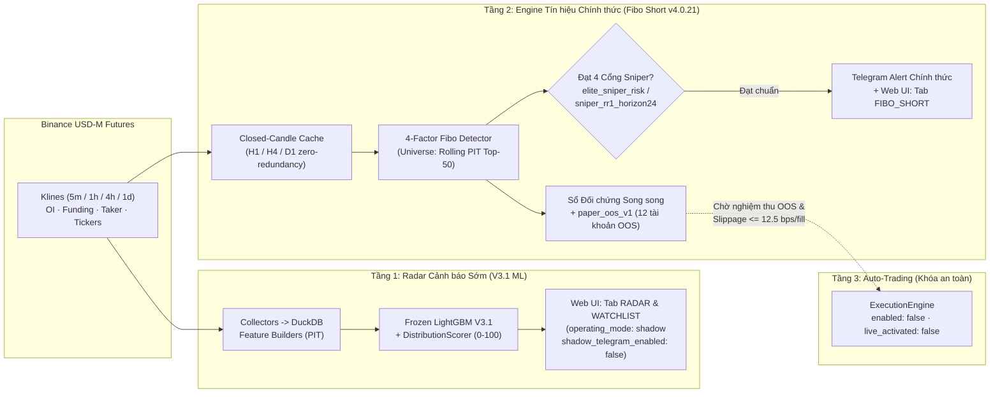

# Kiến trúc Triển khai & Hướng dẫn Vận hành Bản Chính thức — PeakPulse AI

Tài liệu này quy định **kiến trúc vận hành chính thức (Official Production Architecture)** của ứng dụng **PeakPulse AI (Đào Vàng)**, giải thích cơ sở định lượng cho quyết định phân tầng giữa **`Fibo Short v4.0.21`** và **`V3.1 Săn Đỉnh`**, đồng thời hướng dẫn chi tiết cách đọc tín hiệu, quản trị rủi ro và vận hành hệ thống 24/7.

---

## 1. Quyết định Kiến trúc: Vì sao chọn `Fibo Short` làm Engine Chính thức và chuyển `V3.1` thành Radar Sớm?

Qua đối chiếu thực nghiệm trên dữ liệu lịch sử nhiều chu kỳ, kiểm toán hạch toán danh mục đồng thời (Coupled Portfolio Accounting) và mô phỏng tài khoản thực tế, hai nhánh thuật toán bộc lộ đặc tính hoàn toàn khác nhau:

| Tiêu chí đối chiếu | Tầng 1: `V3.1 Săn Đỉnh` (`frozen_20260906_105716_bc3c369b`) | Tầng 2: `Fibo Short` (`dao_vang.fibo_short` · `v4.0.21` / `v4.0.26`) |
|---|---|---|
| **Vai trò chính thức trên Production** | **Radar Cảnh báo Sớm trên Web UI (`RADAR` / `WATCHLIST`)** — **TẮT bắn Telegram trực tiếp** (`shadow_telegram_enabled: false`) | **Engine Tín hiệu Hành động Chính thức (`FIBO_SHORT` + Telegram Alert 24/7)** (`telegram_enabled: true`) |
| **Thời điểm kích hoạt** | Quét khi coin đang bơm nóng (`gainers >= +10%/24h`) kèm kiệt sức Funding (`Funding Exhaustion`) | Chỉ kích hoạt **sau khi đỉnh đã tạo xong**, có sóng xả thực sự (`KER >= 0.50`), giá hồi nông về Fibonacci và **phá đáy cấu trúc H1 (`Close < Low[-1]`)** |
| **Kế hoạch giao dịch (Trade Setup)** | Chỉ cung cấp xác suất ML (`0.20–0.41+`) & điểm rủi ro `0–100`; không có SL/TP cấu trúc sóng | Xuất đầy đủ: `Entry`, `SL Fibo 0.886` (trần `<= 12%`), `TP1 (40%, dời SL hòa vốn)`, `TP2 (40%, dời SL về TP1)`, `TP3 (20%)`, khối lượng `% NAV` theo rủi ro `0.5% NAV` |
| **Bằng chứng sống còn tài khoản** | Không SL chạm ngưỡng thanh lý (`MaxDD ~100%`, vụ `AKEUSDT` x22); áp 12 phương án SL/Time-stop vẫn âm `10/10` cấu hình 5 vị thế (`docs/ACCOUNT_RISK_COMPARISON_20260924.md`) | Kiểm toán 6 năm `2020–2025` trên 338 coin Point-in-Time & `360.781` sự kiện funding thực: `elite_sniper_risk` lãi ròng **`+26.19%`**, `MaxDD 15.33%`, thắng **5/6 năm** (kể cả bull-run 2021 `+2.82%`) |
| **Hiệu suất 2 năm gần nhất (`2024–2025`)** | Chưa đạt cổng forward-test độc lập (`insufficient_evidence` — `docs/PRODUCTION_MODEL.md`) | `sniper_rr1_horizon24` lãi ròng **`+21.46%`** (CI 95% trung bình tuần hoàn toàn dương `[+0.0727%; +0.2992%]`), vẫn lãi **`+1.70%`** dưới tra tấn chi phí `55.0 bps/fill` |

### Nguyên tắc phối hợp 2 tầng (Không chồng chéo, không nhiễu tín hiệu)
1. **Không dùng `V3.1` để bắt đỉnh (Short sớm) ngược nến xanh:** Việc Short ngay khi coin đang tăng thẳng đứng dễ dính các pha kéo rướn x2–x10 trước khi phân phối thật sự. Tuy nhiên, V3.1 rất mạnh trong việc **phát hiện sớm danh sách Altcoin đang quá nhiệt Funding** để hiển thị liên tục trên tab `RADAR` cho người dùng theo dõi thị trường mỗi 5 phút.
2. **Chỉ nhận cảnh báo Telegram và lập kế hoạch giao dịch từ `Fibo Short` (`v4.0.21`):** Tần suất của Fibo Short rất chọn lọc (trung bình ~130–170 tín hiệu chuẩn Sniper/năm trên rổ 50 coin thanh khoản tốt nhất). Mỗi tin nhắn Telegram bắn về đều đã vượt qua đủ 4 cổng kiểm định định lượng.

---

## 2. Sơ đồ Luồng Vận hành Bản Chính thức (`configs/live.yaml`)




### Cấu trúc 4 Tab Lớn trên Giao diện Web & Mobile
Giao diện ứng dụng được tổ chức thành **4 Tab Lớn** tách biệt rõ ràng theo đúng vòng đời nghiên cứu $\to$ kiểm chứng giả lập $\to$ giao dịch tài khoản thực $\to$ quản trị hệ thống:

1. **`Tín hiệu` *(Mặc định khi mở ứng dụng — Tín hiệu & Chi tiết Phương pháp Giao dịch)*:**
   - **`Fibo Short v4.0 (Chính)`:** Bảng tín hiệu Short chính thức (`4H/1D -> 1H`), checklist 4 cổng Sniper, thang giá Fibonacci và nút chuyển 1 chạm sang biểu đồ đặt lệnh.
   - **`Biểu đồ & Lệnh`:** Biểu đồ nến TradingView chi tiết của đồng coin đang chọn, khung tính khối lượng theo rủi ro `0.5% NAV` và Trợ lý Phân tích AI.
   - **`Phương pháp & Kiểm toán`:** Hồ sơ giải thích phương pháp 4 nhân tố (`F1–F4`), kết quả kiểm toán danh mục 6 năm (`2020–2025`), sơ đồ Kiến trúc 2 Tầng và thư viện báo cáo định lượng.
   - **`Radar Quá Nhiệt (V3.1)` · `Bảng Ứng viên (V3.1)` · `Thị trường`:** Tầng quét sớm các Altcoin đang bơm nóng & kiệt sức Funding cùng bức tranh vĩ mô toàn sàn Binance.
2. **`Shadow Live` *(Các Version & Các Bản Cải Tiến Chạy Giả Lập Thời Gian Thực)*:**
   - **`Paper OOS v1 (12 Tài khoản)`:** Giám sát trực tiếp tiến trình `daovang-oracle-paper_oos` (`6 phiên bản chiến lược × 2 kịch bản chi phí Chuẩn 12.5 bps / Stress 55 bps`, đường cong NAV 100, kiểm chứng SHA-256).
   - **`Đối chiếu Phiên bản (Cũ vs v4.0)`:** Sổ đối chứng song song thời gian thực giữa bản M1 gốc không lọc và các bản cải tiến `v4.0.21` (thống kê số kèo nhiễu bị chặn và hiệu quả dời SL hòa vốn sau TP1).
   - **`Forward & So sánh Bộ lọc`:** Tiến độ kiểm chứng forward-test và so sánh phiên bản bộ lọc `V1 vs V2` *(cùng `Backtest ML` & `Quét đa khung` khi bật Dev Mode)*.
3. **`Live` *(Bản Chạy Live Nối Với Tài Khoản Thực Binance Futures)*:**
   - **`Tài khoản Thực Binance`:** Hiển thị trực tiếp số dư ví USDT, tài sản khả dụng, PnL chưa chốt, đường cong tài sản (`24h / 7d / 30d`), vị thế & lệnh chờ thực tế trên sàn Binance và cổng kiểm soát thực thi.
   - **`Vị thế Theo dõi`:** Sổ quản lý các vị thế/mã đang theo dõi thủ công.
4. **`Hệ thống` *(Vận hành & Quản trị)*:**
   - **`Cài đặt` · `Hạ tầng & Trạng thái` · `Lịch sử` · `Phiên bản`** *(và `Kiểm định ML V3.1` khi bật Dev Mode)*.

### Cơ chế Phân quyền 2 Cấp: Người dùng Thường (Guest Read-Only) & Quản trị viên (Admin)
- **Người dùng thường (Truy cập trực tiếp `https://pulse.freqpilot.dev` không cần mật khẩu):**
  - Xem toàn bộ tín hiệu **`Fibo Short v4.0.21`**, biểu đồ nến & thang giá vào lệnh/SL/TP, link mở thẳng từ Telegram (`#coin=SYMBOL`), **`Shadow Live` 12 tài khoản Paper OOS**, **`Live` Paper 10.000 USD & Ví Binance ở chế độ Chỉ xem (Read-Only)**, cùng toàn bộ hồ sơ kiểm toán 6 năm & lịch sử phiên bản.
  - Tính năng **`Vị thế Theo dõi`** tự động lưu riêng tư ngay trên trình duyệt (`localStorage`) của từng người dùng mà không làm ảnh hưởng dữ liệu máy chủ.
- **Quản trị viên (`🔑 Admin` góc phải trên thanh Header):**
  - Bấm **`Admin`** và nhập mật khẩu quản trị (`HttpOnly` session cookie) khi cần sử dụng **Trợ lý AI Định lượng (LLM)**, mở tab **Cài đặt Hệ thống**, đổi chế độ/danh sách quét máy chủ, bắn tin Telegram thủ công, đồng bộ Vị thế Theo dõi trên Server hoặc bấm **Dừng mở mới / Bật lại / Đóng thủ công** trên tab `Live`.
---

## 3. Hướng dẫn Đọc hiểu & Giao dịch Tín hiệu `Fibo Short` (`v4.0.21`)

### 3.1. Bốn cổng điều kiện bắt buộc trước khi hệ thống báo Telegram
Một đồng coin chỉ được bắn thông báo **`🔻 SHORT SYMBOL`** qua Telegram khi thỏa mãn đồng thời cả 4 nhân tố (`is_qualified_short_for_telegram`):

1. **Nhân tố F1 — Vũ trụ Coin & Biên độ Bơm trước đó (`Macro & Universe`):**
   - Thuộc rổ **`rolling_pit_top50`**: Top 50 Altcoin có thanh khoản trung vị 63 ngày cao nhất, lịch sử giao dịch $\ge 50$ ngày, độ giật râu nến H4 `p90 <= 3.2%`, loại bỏ các coin vốn hóa siêu lớn/neo giá (`BTCUSDT`, `ETHUSDT`, `BNBUSDT`, vàng, stablecoins).
   - Đã có nhịp bơm trước đó **`Prior Pump >= +50%`** (`telegram_min_prior_pump_pct: 0.50`).
2. **Nhân tố F2 — Chất lượng Sóng xả Xác nhận Đỉnh (`Impulse Quality`):**
   - Từ đỉnh swing trên khung `H4` hoặc `D1`, giá đã sập một nhịp rõ rệt **`Impulse Drop >= 6%`** với chỉ số hiệu quả đường đi **`Impulse KER >= 0.50`** (sóng bán dứt khoát của dòng tiền lớn, không phải đi ngang cưa răng lược).
3. **Nhân tố F3 — Hồi quy Fibonacci nông & Phá vỡ Cấu trúc H1 (`Pullback & Trigger`):**
   - Giá hồi lên vùng Fibonacci nông (`<= 0.786`, tối ưu `0.382–0.618`) nhưng không vượt đỉnh cũ.
   - Nến `H1` đóng cửa **đỏ / không tăng (`no_gain_1h`)** VÀ **đóng cửa phá thủng đáy cây nến H1 liền trước (`Close < Low[-1]`)**.
4. **Nhân tố F4 — Kỷ luật Cắt lỗ, Chốt lời Bậc thang & Chính sách Sniper (`Execution & Risk`):**
   - Khoảng cách cắt lỗ `SL (0.886)` không vượt quá trần `12%` từ giá vào (`sl_within_cap`).
   - Khớp ít nhất 1 trong 2 chính sách chuẩn Production:
     - **`👑 Elite + Sniper` (`elite_sniper_risk`):** Điểm hội tụ cao + cấu trúc sóng bền bỉ nhất xuyên chu kỳ 6 năm (`2020–2025`: `+26.19%`, MaxDD `15.33%`), thời gian giữ tối đa `72h` (`4H`) / `120h` (`1D`).
     - **`🎯 Sniper RR≥1 · 24h` (`sniper_rr1_horizon24`):** Tỷ lệ Lợi nhuận/Rủi ro ngay tại TP1 đạt `RR >= 1.0`, đánh nhanh rút gọn tối đa **`24 giờ`**, hiệu suất 2 năm gần nhất dẫn đầu (`2024–2025`: `+21.46%`).

### 3.2. Cách đọc một tin nhắn Telegram chính thức & Tính khối lượng vào lệnh

Ví dụ tin nhắn Telegram từ hệ thống:
```text
🔻 SHORT SOLUSDT (4H → H1)
🛡 👑🎯 Elite + Sniper RR≥1 | Điểm: 84 (Hạng S)
🟡 Entry: $142.50 (Fibo 0.552)
🛑 SL (0.886): $148.20 (+4.00%)
🟢 TP1 (40%): $133.95 (-6.00%) · dời SL hòa vốn
🎯 TP2 (40%): $129.30 (-9.26%) · dời SL về TP1
🚀 TP3 (20%): $123.40 (-13.40%)
⚖️ R:R: 1:2.31 | Vốn: 12.5% NAV (Risk 0.5%) | Giữ: 24h
```

**Quy tắc thực thi chuẩn (Human-in-the-Loop):**
1. **Định cỡ vị thế theo rủi ro `0.5% NAV` (`Vốn: 12.5% NAV`):**
   - Công thức chuẩn hóa rủi ro:
     $$\text{Giá trị vị thế danh nghĩa (Notional)} = \min\left(20\% \times \text{NAV},\ \frac{0.5\% \times \text{NAV}}{\text{Khoảng cách SL (\%)}}\right)$$
   - Ví dụ: Tài khoản Futures có `NAV = 1,000 USDT` $\Rightarrow$ rủi ro tối đa cho lệnh này là `0.5% * 1,000 = 5.0 USDT`. Vì `SL` cách `Entry` là `+4.00%`, tổng quy mô vị thế danh nghĩa là `5.0 / 0.04 = 125 USDT` (`12.5% NAV` — nếu dùng đòn bẩy `x5` thì ký quỹ chỉ tốn `25 USDT`). Nếu dính SL, tài khoản chỉ mất đúng `~5 USDT` (`0.5% NAV`).
2. **Quản lý lệnh 3 bậc (Ratcheted Exit) & Kiểm soát Trượt giá:**
   - Đặt sẵn **Stop-Market** bảo vệ tại `SL (0.886)`.
   - Đặt **Limit Post-Only / Take-Profit Limit** cho **`TP1 (40%)`** và **`TP2 (40%)`** để tránh mất `10–50 bps` trượt giá lệnh Market (kiểm toán `v4.0.9` chứng minh kiểm soát trượt giá dưới `12.5 bps/fill` là chìa khóa giữ nguyên lợi thế `+26.19%`).
   - Ngay khi khớp **`TP1`**: **dời SL của 60% vị thế còn lại về giá `Entry` (Hòa vốn)** — khóa rủi ro thua lỗ về `0`.
   - Ngay khi khớp **`TP2`**: **dời SL của 20% vị thế cuối về giá `TP1`**.
   - Nếu hết thời gian **`Giữ: 24h`** (hoặc `72h` với lệnh Elite không giới hạn 24h) mà chưa chạm đủ TP3: chủ động đóng phần còn lại để giải phóng vốn và tránh phí funding âm kéo dài.

---

## 4. Các Chốt Chặn An Toàn Kỹ Thuật (Production Safeguards)

1. **Cách ly tuyệt đối Môi trường `Dev` và `Live` (Khóa Kép Telegram):**
   - Trong `configs/dev.yaml`: `scanner.operating_mode: research` và `fibo_trend_short.telegram_enabled: false`.
   - Trong mã nguồn `src/dao_vang/fibo_short/scanner_lane.py` (`dispatch_fibo_telegram_signal`): kiểm tra cứng `operating_mode == "research"` (`research_mode_blocked`) và `KillSwitch` (`kill_switch_active`) trước mọi lệnh gọi `TelegramNotifier`. Ngay cả khi lập trình viên vô tình bật `telegram_enabled: true` trên máy Dev có chứa `.env`, chế độ `research` vẫn chặn 100% tin nhắn phát ra ngoài.
2. **Giám sát Sức khỏe Hợp nhất tại `/api/ready` (`healthcheck.py` & `api_server.py`):**
   - `ScannerDaemon` ghi trực tiếp trạng thái thực thi của nhánh `fibo_trend_short` (`ok` / `failed`, số mã quét, thời điểm cập nhật) vào `scanner_heartbeat.json`.
   - Nếu nhánh `fibo_trend_short` đang bật (`enabled: true`) nhưng gặp lỗi (`status: failed`), cả CLI Docker healthcheck lẫn HTTP `GET/HEAD /api/ready` sẽ lập tức trả về **`HTTP 503` (`reason: fibo_trend_short_failed`)** để hệ thống giám sát phát hiện ngay, không bị che khuất bởi heartbeat của tầng V3.1.
3. **Bộ đệm Nến Đóng Thông minh (`Closed-Candle Cache`):**
   - Tín hiệu Fibo Short chỉ sử dụng các cây nến `1h`, `4h`, `1d` **đã đóng hoàn tất**. `fetch_closed_klines()` lưu cache theo mốc `expected_last_open_ms` của khung giờ hiện tại, giảm **>96% số lượng request REST klines** lên Binance trong các chu kỳ quét 5 phút liên tiếp, trong khi vẫn cập nhật bảng giá ticker thời gian thực mỗi 5 phút để theo dõi khớp `TP1 / BE / SL` trên Sổ Đối chứng Song song (`shadow_comparison`) và tự động làm mới ngay giây đầu tiên khi nến giờ mới đóng cửa.
4. **Khóa Giao dịch Tự động Tiền thật (`ExecutionEngine` Fail-Closed):**
   - Trong `configs/live.yaml`, `execution.enabled: false` và `execution.live_activated: false`. Nhánh kiểm định OOS thời gian thực (`paper_oos_v1`) chạy hoàn toàn độc lập ở chế độ chỉ đọc dữ liệu thị trường công khai, tuyệt đối không gửi lệnh lên sàn.

---

## 5. Sổ tay Vận hành Nhanh (Quick Operations Checklist)

### Khởi chạy môi trường
```bash
# 1. Môi trường Dev (Port API 8000 + UI 5173, data/dev.duckdb, KHÔNG bắn Telegram)
.\scripts\windows\run_dev.bat

# 2. Môi trường Production bằng Docker Compose (Khuyên dùng trên Server)
docker compose up -d --wait scanner web

# 3. Kiểm tra trạng thái sẵn sàng của cả Scanner V3.1 + Nhánh chính thức Fibo Short
curl -s http://127.0.0.1:8000/api/ready | python -m json.tool
```

### Triển khai lên Máy chủ Production Oracle Cloud (OCI — Dokploy)
Hệ thống Live Production vận hành trên **Oracle Cloud Infrastructure (`opc@161.118.250.182`, ARM64 `oracle-free-vm-01`)** dưới cụm Dokploy Compose (`/etc/dokploy/compose/daovang-daovang-beta-bw9sz2/files/runtime`, cổng web nội bộ `127.0.0.1:18000`):
- **5 Container đang chạy:**
  - `daovang-oracle-scanner` (`configs/msi-production.yaml` — Tầng 1 V3.1 UI Radar + Tầng 2 Fibo Short v4.0.21 Telegram chính thức)
  - `daovang-oracle-web` (`127.0.0.1:18000:8000` — API + React UI 4 Tab Lớn)
  - `daovang-oracle-execution` (`Paper Simulation 10,000.00 USDT` nối trực tiếp nguồn tín hiệu `fibo_short`, `live_activated: false`)
  - `daovang-oracle-paper_oos` (`paper_oos_v1` 12 tài khoản OOS độc lập — giữ chạy liên tục không gián đoạn)
  - `daovang-oracle-tunnel` + `dokploy-traefik` (nối domain chính thức **`https://pulse.freqpilot.dev`** và song song `https://daovang.comaygiauco.com`)
- **Lệnh deploy an toàn từ máy Local (`scripts/deploy_oracle_server.py`, tự động dùng `IdentitiesOnly=yes` và tạo bản sao lưu `/var/backups/dao-vang/`):**
  ```bash
  # 1. Build frontend mới nhất & kiểm tra dry-run gói deploy
  cd frontend && npm run build && cd ..
  python scripts/deploy_oracle_server.py --key "<DUONG_DAN_FILE_ORACLE_KEY>"

  # 2. Thực thi deploy lên Oracle Cloud (chỉ restart scanner & web, giữ nguyên paper_oos + tunnel)
  python scripts/deploy_oracle_server.py --key "<DUONG_DAN_FILE_ORACLE_KEY>" --apply
  ```

### Ý nghĩa kết quả `/api/ready`
- `status: "ok"` (HTTP `200`): Cả tiến trình Web, Scanner V3.1, nhánh chính thức `fibo_trend_short` (`checks.fibo_trend_short.status == "ok"`) và dung lượng ổ đĩa đều khỏe mạnh.
- `checks.scanner.reason: "fibo_trend_short_failed"` (HTTP `503`): Nhánh Fibo Short gặp sự cố (ví dụ mất kết nối Binance Futures hoặc lỗi quyền ghi thư mục `data_live/fibo_trend_short/`). Kiểm tra ngay log container `docker compose logs --tail=100 scanner`.

### Ngắt khẩn cấp toàn bộ cảnh báo Telegram (Emergency Kill Switch)
Khi cần tạm dừng toàn bộ thông báo Telegram trên môi trường Live mà không muốn tắt tiến trình thu thập dữ liệu:
```bash
python -c "from dao_vang.scanner.operations import KillSwitch; KillSwitch('data_live/scanner_kill_switch.json').activate('Bao tri khan cap')"
```
Để mở lại cảnh báo sau khi kiểm tra xong:
```bash
python -c "from dao_vang.scanner.operations import KillSwitch; KillSwitch('data_live/scanner_kill_switch.json').clear()"
```
